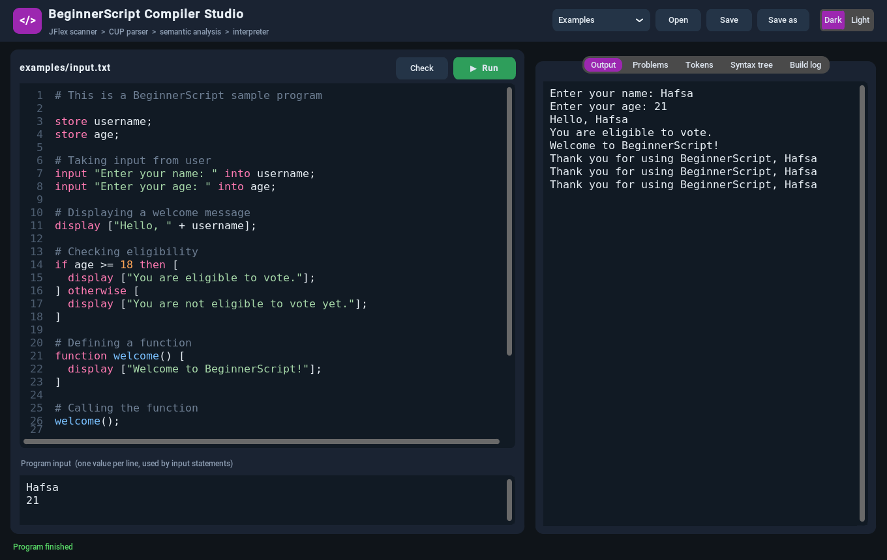
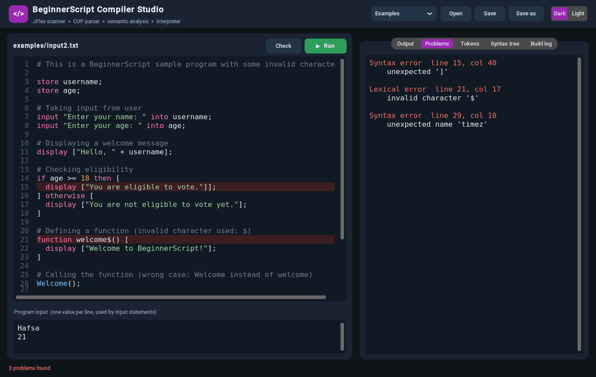
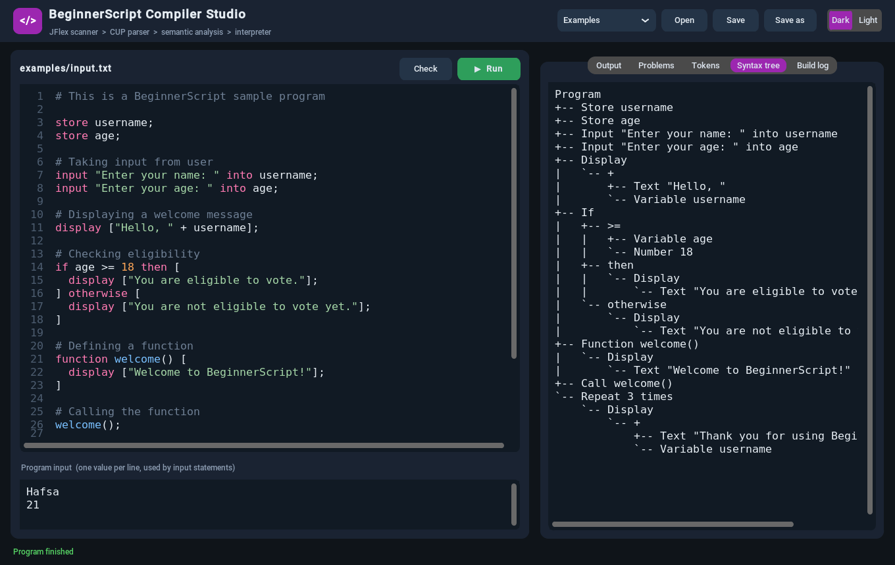
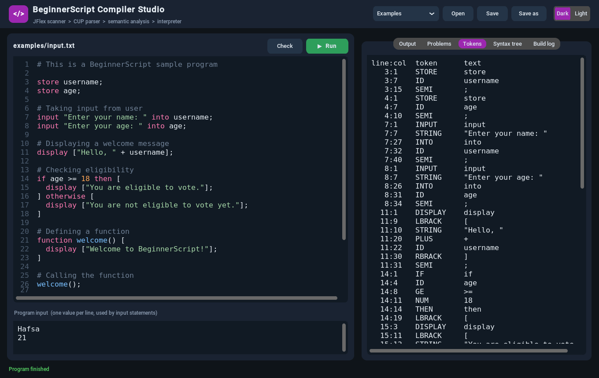
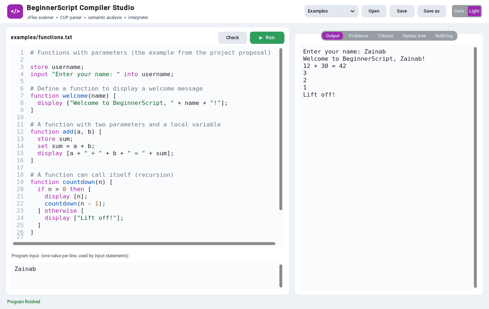

# BeginnerScript Compiler

Compiler Construction semester project: a complete compiler for **BeginnerScript**, a small programming language for children and new programmers, built with **JFlex** (lexical analysis), **CUP** (syntax analysis) and **Java**, plus a desktop IDE, **Compiler Studio**, written in Python.

**Group members**
- Hafsa Khurram (FA22-BCS-058)
- Zainab Asif (FA22-BCS-068)
- Atta Noor (FA22-BCS-095)



---

## What the compiler does

| Phase | File | What it does |
|---|---|---|
| Lexical analysis | `scanner.jflex` (JFlex) | Turns the source into tokens with line and column numbers; reports invalid characters, unclosed strings and numbers that are too large |
| Syntax analysis | `parser.cup` (CUP) | Checks the grammar, recovers from errors to report all of them, and builds an abstract syntax tree (`Ast.java`) |
| Semantic analysis | `Semantic.java` | Variables must be stored before use and only once per scope; functions must exist and get the right number of arguments; simple type checks |
| Execution | `Interpreter.java` | Runs the program: input, output, if/otherwise, loops, functions with parameters and recursion |

Every error says where it is and what is wrong, for example:

```
Syntax error at line 2, column 1: unexpected 'set' (is a ';' missing before it?)
Semantic error at line 26, column 1: function 'Welcome' is not defined (did you mean 'welcome'?)
Runtime error at line 4, column 13: division by zero
```

## Compiler Studio

| Errors are listed and marked in the editor | The syntax tree built by the parser |
|---|---|
|  |  |

| Tokens from the scanner | Light theme |
|---|---|
|  |  |

- Code editor with line numbers and syntax colours
- **Run** (F5) compiles and runs the program; **Check** only compiles it
- Separate box for the program's input (one value per line)
- Tabs for every phase: Output, Problems, Tokens, Syntax tree, Build log
- Click a problem to jump to its line; error lines are highlighted
- Open / Save (Ctrl+O / Ctrl+S), an Examples menu, and a Dark / Light theme
- Rebuilds the compiler automatically when `scanner.jflex`, `parser.cup` or a `.java` file changes

---

## How to run

### What you need (install once)
1. **Java JDK 11 or newer**: https://adoptium.net (choose the LTS version)
2. **Python 3.8 or newer** (only for Compiler Studio): https://www.python.org/downloads (on Windows tick *Add python.exe to PATH*)

JFlex and CUP do **not** need to be installed: they are included in `lib/`.

### Compiler Studio (GUI)
- **Windows:** double-click `start_gui.bat`
- **macOS / Linux:** `./start_gui.sh`

Or from a terminal in the project folder:
```bash
pip install -r requirements.txt
python gui.py
```

### Command line
```bash
build.bat                      # Windows: build the compiler into build\
run.bat examples\input.txt     # run a program

./build.sh                     # macOS / Linux
./run.sh examples/input.txt
```

Options for `run`: `--tokens` (print the tokens), `--tree` (print the syntax tree), `--check` (compile only, do not run).

```bash
run.bat --tokens --tree examples\input.txt
```

### Tests
```bash
python tests/run_tests.py
```
Builds the compiler and runs 14 test programs (the examples plus programs with lexical, syntax, semantic and runtime errors), checking their exact output.

---

## The BeginnerScript language

| Feature | Example |
|---|---|
| Comment | `# This is a comment` |
| Declare a variable | `store age;` |
| Assign | `set age = 18;` |
| Input | `input "Enter your name: " into username;` |
| Output | `display ["Hello, " + username];` |
| If / otherwise | `if age >= 18 then [ ... ] otherwise [ ... ]` |
| While loop | `while count <= 5 [ ... ]` |
| Repeat loop | `repeat 3 times [ ... ]` |
| Function | `function greet(name) [ display ["Hi " + name]; ]` |
| Call | `greet("Hafsa");` |

- Values are whole numbers or text. `+` adds numbers or joins text; `- * /` work on numbers (`7 / 2` is `3`).
- Comparisons: `>  <  >=  <=  ==  !=` (`==` and `!=` also compare text).
- Variables in the main program are global; each function call has its own local variables and parameters.

Example programs are in [`examples/`](examples): `input.txt` (the sample from the proposal), `input2.txt` (with deliberate errors), `loops.txt`, `functions.txt` and `grades.txt`.

---

## Project structure

```
Compiler-Construction/
├── scanner.jflex        JFlex specification (lexical analysis)
├── parser.cup           CUP grammar, builds the syntax tree
├── Ast.java             syntax tree nodes and tree printing
├── Semantic.java        semantic analysis
├── Interpreter.java     runs the program
├── Main.java            compiler driver (phases, options, exit codes)
├── gui.py               Compiler Studio (CustomTkinter)
├── build.bat / .sh      build the compiler into build/
├── run.bat / .sh        run a program
├── start_gui.bat / .sh  start Compiler Studio
├── examples/            example programs
├── tests/run_tests.py   automated tests
├── lib/                 JFlex 1.9.1 and CUP 0.11b jars (with licences)
└── docs/                project proposal and screenshots
```
